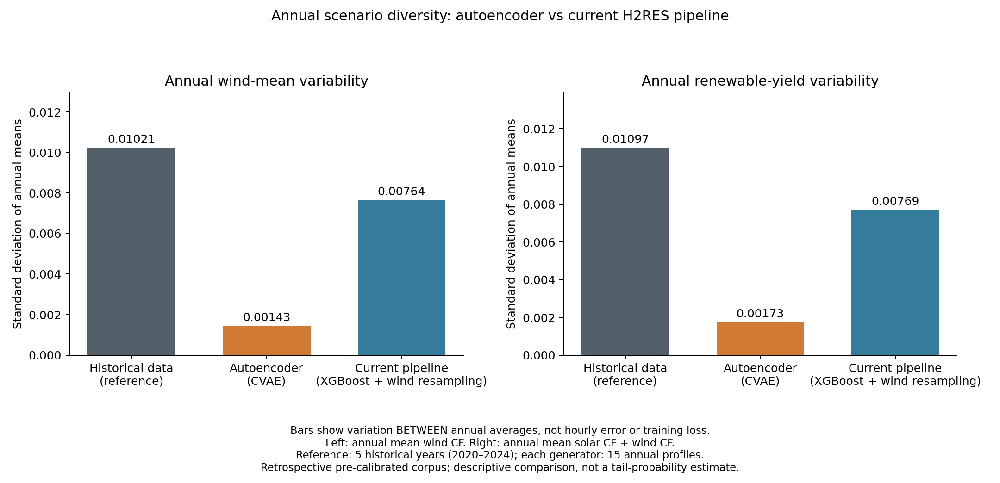

# Autoencoder for annual H2RES climate profiles

Companion implementation: [H2RES climate pipeline](https://github.com/Roko55/H2RES-climate-pipeline).

This experiment generates hourly solar, wind and temperature profiles with a conditional variational autoencoder (CVAE). Calendar features condition a temporal latent representation. Generated profiles have shape `[scenarios, 8760, 3]` and retain the source units.

**Evaluation scope:** the input dataset was calibrated upstream using IRENA years that overlap the reporting period. The results below are a retrospective comparison on a common pre-calibrated corpus, **not an independent temporal holdout**. The model's normalization, night mask and wind thresholds use training years only. See the [audit](AUDIT.md) and [machine-readable input provenance](data_provenance.json).

## Quick start

Use Python 3.11 and run from the repository root:

```bash
git clone https://github.com/Roko55/H2RES-autoencoder.git
cd H2RES-autoencoder
python -m venv .venv
```

Activate with `.\.venv\Scripts\Activate.ps1` on Windows PowerShell, or `source .venv/bin/activate` on Linux/macOS. Then:

```bash
python -m pip install torch==2.8.0 --index-url https://download.pytorch.org/whl/cpu
python -m pip install -r requirements.txt
python -m unittest discover -s tests -v
python audit.py --verify-files
python generate_profiles.py --run runs/study_confirmation_compact_local_hires_prior_matching_seed17_3600s --count 5 --seed 101 --output exports/quickstart_profiles.npy
```

No raw weather data or training is needed for generation from these delivered weights. The output is **relative to the selected run**, not the repository root:

`runs/study_confirmation_compact_local_hires_prior_matching_seed17_3600s/exports/quickstart_profiles.npy`

It has shape `[5, 8760, 3]`, channels `[solar, wind, temperature]`, and units capacity factor, capacity factor, degrees Celsius. The JSON sidecar records the seed, checkpoint/normalization hashes and output hash. Use a new filename on reruns. Optional `--temperature` is a latent sampling scale, not ambient temperature in degrees Celsius.

The exporter samples one path at a time; evaluation's five-path batches can give a different exact seeded sequence. The delivered configuration has limited annual wind diversity, as quantified below. Checkpoint generation is not downstream planning validation.

## Comparison design

| Table column / chart bar | Meaning | Number of annual profiles |
|---|---|---:|
| Historical data (reference) | Solar/wind capacity factors and temperature from the shared source dataset, reporting years 2020–2024. This is the observed-data reference, not an older model. | 5 |
| Autoencoder (CVAE) | One validation-selected conditional variational autoencoder, generating all three channels jointly from sampled latent variables and calendar features. | 15 |
| Current pipeline (XGBoost + wind resampling) | The current-default hybrid refit: autoregressive XGBoost for solar and temperature; seasonal block resampling for wind. Channels are generated separately. | 15 |

The older fixed H2RES input profile is a **separate historical baseline**, available in the supplementary tables. It is not the historical-data reference bar in the main chart.

## Main finding: insufficient annual wind variability

The main comparison uses **one autoencoder checkpoint**, selected on validation data before reporting evaluation, against the current-default XGBoost/seasonal-bootstrap refit. It is not reselected using the reporting scores. The CVAE has 167,343 parameters and 8,760 temporal latent elements per annual path. Models were fitted on 1980–2015, selected using 2016–2019 and compared retrospectively on 2020–2024 (all 43,800 non-leap hours). Three fixed sampling seeds supply 15 generated annual paths per method.

H2RES uses low, average and high annual renewable-resource cases. The relevant limitation is the autoencoder's **narrow spread of annual wind means**, which also narrows annual renewable yield. It is not a claim that every hourly metric is worse.

| Application diagnostic | Historical data (reference) | Autoencoder (CVAE) | Current pipeline (XGBoost + wind resampling) |
|---|---:|---:|---:|
| SD of annual wind means (capacity factor) | 0.01021 | 0.00143 | 0.00764 |
| Wind annual-mean SD / observed SD | 100% | 14.0% | 74.8% |
| SD of annual renewable-yield index | 0.01097 | 0.00173 | 0.00769 |
| Mean low-wind episode duration (hours) | 3.18 | 5.55 | 4.64 |
| Mean high-wind episode duration (hours) | 2.19 | 4.39 | 3.68 |

**How to read the chart:** each bar shows the standard deviation (SD) across annual averages, not an average hourly error or training loss. First compute the mean wind capacity factor of each year, then calculate how much those annual means differ. A shorter bar means the generated years are more similar in their annual resource availability. The reference is the grey bar. For wind, the autoencoder retains only 14.0% of that spread, compared with 74.8% for the current pipeline. The right panel applies the same calculation to the combined renewable-yield index.

The yield index is annual mean solar CF + wind CF, not actual system generation. Wind episodes use training-set 10th/90th percentile thresholds; durations are averaged within each annual path and then across paths. These are selected **application diagnostics**, not an exhaustive quality ranking or prespecified rejection thresholds. Five observed years versus 15 generated years support descriptive comparisons, not calibrated tail probabilities.



**Statistical scope:** the autoencoder performs better on several marginal and persistence diagnostics, and on the declared composite score (0.1950 versus 0.3064; lower is better). The pipeline also underrepresents annual solar and temperature variability. Neither generator is uniformly superior. The retained pipeline offers more wind-driven annual diversity for this application; this comparison does not establish better H2RES investment outcomes, since no solver was rerun.

### Measured time and memory

| Measurement | Autoencoder (CVAE) | Current pipeline (XGBoost + wind resampling) |
|---|---:|---:|
| Training / preparation time | 3,600 s (60 min) | 131 s (2 min 11 s) |
| Peak process RAM during that stage | 1,477 MiB | 1,012 MiB |
| Generate 15 annual profiles on the same CPU, after loading and warmup | 2.386 s | 52.285 s |

The first row measures different preparation workflows: time-bounded CVAE training on a Quadro P2000 versus the default hybrid's GPU fitting, CPU calibration and preparation overhead. It is not a matched-hardware training benchmark or time to an equal quality target. Peak RAM is process RAM, not installed RAM or GPU memory. The generation row is a separate measurement on the common CPU and excludes loading/warmup; see [training resources](results/training_resources.csv) and [inference resources](results/inference_resources.csv).

The autoencoder needs more preparation time in these recorded runs but generates faster once ready. **The decisive limitation highlighted here is annual wind diversity**, not demonstrated memory exhaustion or slow generation.

### Generative diversity and model scope

Generated hourly profiles vary, but their annual wind means are narrowly distributed. The unpaired annual-mean matching term can favour central annual statistics; its contribution has not been isolated by an ablation. Annual-state conditioning, the loss and the latent representation are potential directions for further study. The comparison covers the evaluated configuration and training budgets. See [the model audit](AUDIT.md#annual-wind-variability).

### Complete evidence

The main narrative fixes one autoencoder and one default pipeline. Other recorded configurations are retained as supplementary research evidence, not mixed into the primary model's results. The [full results guide](RESULTS.md), [all comparison scores](results/aggregate_scores.csv), [individual errors](results/aggregate_individual_metrics.csv), [annual spread](results/annual_mean_spread.csv), [resource measurements](results/training_resources.csv), [inference timings](results/inference_resources.csv) and [broader quality figure](figures/comparison_quality.png) remain available, including results favourable to the autoencoder. [Application table source](results/application_comparison.csv) and [presentation script](analysis/present_application_comparison.py) make the focused view reproducible without fitting or selection.

The original fixed H2RES inputs are an additional historical baseline in the full tables; their temperature is a training-climatology proxy. Individual-path and ensemble-mean errors remain separate. This retrospective suitability check supports the stated application rationale; it is not a dated record proving which diagnostics caused the original development decision.

## Data-dependent evaluation

The generator checks checkpoint and normalization hashes and rejects existing output files. Missing or changed weights never produce a zero-profile substitute.

To check training statistics and reevaluate the prior, supply the exact `HR_data.parquet` and write into a new ignored export directory:

```bash
python audit.py --data data/HR_data.parquet
python evaluate.py --data data/HR_data.parquet --split test --output exports/replay_01
```

`evaluate.py` verifies both weights and normalization against the training record and frozen manifest **before deserialization**, then compares the saved normalization with training-only statistics. It samples from the prior using calendar conditions only. The maintained export uses the same calendar precision as evaluation; the audit explains the earlier replay discrepancy. The original mixed reconstruction/prior evaluator is retained in `study_runner.py` for execution traceability; use `evaluate.py` for new prior evaluations.

The supplied corpus is intentionally rejected by `python audit.py --strict-holdout`. A strict new temporal study requires rebuilding upstream calibration without reporting-period information, followed by fresh training, validation selection and evaluation. Relabelling the existing results or dividing by rounded calibration factors does not repair that limitation.

## Reproduce or extend

The required input SHA256 is `d92748ca6625d0092b073b9bc16345da960a04c42da29926da5b125a63ad122d`. Place the exact file in `data/`; no dataset is downloaded automatically. For full baseline recomputation, also supply `data/original_genco.csv` and `data/original_ncre.csv` matching `results/input_hashes.json`, then run `python analysis/compare_profiles.py`. That analysis uses preserved generated paths; it does not train or select models.

For a new time-bounded training run, choose a new directory:

```bash
python study_runner.py train --variant compact_local_hires_prior_matching --seed 17 --seconds 900 --epochs 100 --device cpu --output runs/local_example
python evaluate.py --run runs/local_example --split validation --output exports/local_validation
python freeze_evaluation.py --runs runs/local_example --selected-run runs/local_example --validation-dir exports/local_validation --output provenance/local_freeze.json
python evaluate.py --run runs/local_example --split test --freeze-manifest provenance/local_freeze.json --output exports/local_reporting
```

New models are not automatically registered in the existing test freeze. Preserve validation evidence and create a separate freeze before any new reporting evaluation; do not choose a favourable reporting seed. `freeze_evaluation.py` checks that the supplied summary is validation output. Without `--validation-dir`, it uses the original run's `study_validation/` directory.

The default resource guard reserves 2 GiB of free memory, uses one CPU thread and lowers Windows process priority. A `STOP_STUDY` file stops only this experiment's work. GPU work defers when another or unidentified computation is present. Recorded faculty runs reserved 128 GiB; installed machine RAM is not process use. Preparation, loading, warmup and generation times are separate in the tables.

## Code map

| File/directory | Purpose |
|---|---|
| `study_models.py` | Temporal CVAE, reference variants and loss functions |
| `study_data.py` | Chronological splits, training-only transforms and overlapping windows |
| `study_runner.py` | Original bounded training/evaluation implementation |
| `evaluate.py`, `audit.py` | Maintained prior evaluation and integrity/provenance checks |
| `generate_profiles.py` | Checkpoint-based H2RES export |
| `study_metrics.py` | Distribution, persistence, ramp and episode metrics |
| `study_runtime.py` | Process-local resource guards |
| `analysis/`, `tests/` | Comparison recomputation and synthetic regression tests |
| `runs/`, `frozen_outputs/` | Selected weights, execution records and generated samples |
| `provenance/` | Validation selection, test freezes and exact executed sources |
| `src/ai_engine.py` | Byte-preserved historical reference; its old fidelity claims are not validation evidence |

No access helpers, credentials, solver licences, raw training wind pools, vendored environments or unrelated working scripts are included in this experiment. Native hybrid models belong to the pipeline and are not duplicated here. Original deliveries and measured model weights are unchanged. Rights for third-party inputs and code remain with their respective owners; this experiment does not assign them a new licence.

This repository is a research experiment; the companion pipeline supplies the H2RES unit-mapping and thermal adapters. Another input corpus needs a separately trained, validated and frozen experiment. Clean Linux/Python 3.11 CI verifies checkpoint generation and synthetic tests. See [RIGHTS.md](RIGHTS.md) for reuse conditions.
