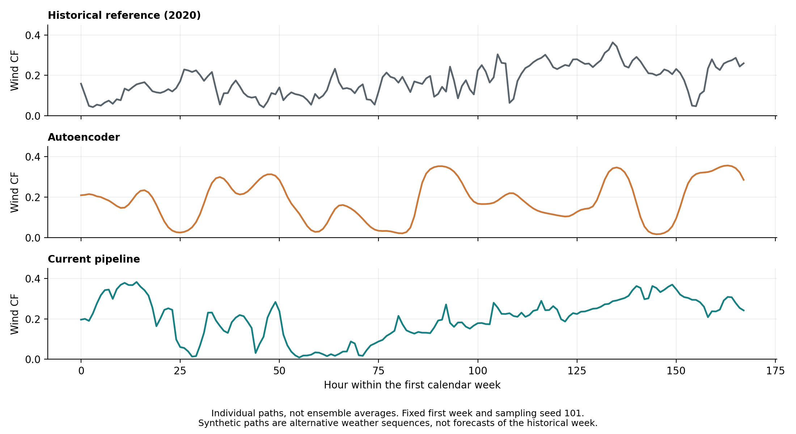

# Autoencoder for annual H2RES climate profiles

Companion implementation: [H2RES climate pipeline](https://github.com/Roko55/H2RES-climate-pipeline).

This repository presents one conditional variational autoencoder (CVAE),
selected using validation data, for generating annual solar, wind and
temperature profiles. The application comparison is against historical data
and the XGBoost/seasonal-bootstrap climate pipeline.

## Generate profiles

Install the dependencies in `requirements.txt` in a Python 3.11 environment.
For CPU-only PyTorch, use its official CPU wheel index. From the repository root:

```bash
python corrected_study/generate_profiles.py --run runs/compact_local_hires_prior_matching_seed17_1800s_retry01 --count 5 --seed 101 --output exports/profiles_01.npy
python -m unittest discover -s corrected_study -p test_study.py -v
python analysis/plot_corrected_wind.py
```

The selected checkpoint has 167,343 parameters. The checkpoint, normalization
and generation implementation are included in [corrected_study](corrected_study/README.md).
No raw input data or retraining is required to generate profiles.
Output has shape `[5, 8760, 3]`, with channels solar CF, wind CF and temperature
in degrees Celsius. The output path is relative to the selected run; use a new
filename on reruns. Its JSON sidecar records hashes and the sampling seed.
Sampling scale 1 is the comparison setting, not ambient temperature.

## Why retain wind resampling for H2RES resource cases?

The relevant distinction is annual resource variability, not whether an
autoencoder can produce a changing hourly curve. In this sample, the
autoencoder's annual wind means are more narrowly distributed than the
historical reference and the climate pipeline. This limits the contrast
between low, average and high annual resource cases.

| Diagnostic | Historical reference | Autoencoder | Climate pipeline |
|---|---:|---:|---:|
| SD of annual mean wind CF | 0.007968 | 0.002258 | 0.005439 |
| Fraction of historical annual-mean variability | 100% | 28.3% | 68.3% |
| Mean 95th-percentile absolute hourly wind ramp | 0.090553 | 0.057743 | 0.085004 |


Each dot represents one annual profile, not an ensemble mean or hourly error.
The historical reference contains five years; each generator supplies 15
annual paths using fixed sampling seeds 101-103. These are descriptive
comparisons, not calibrated estimates of rare-event probabilities.



The first calendar week and sampling seed 101 are fixed before plotting.
Generated paths are alternative weather sequences, not forecasts of that
historical week. The autoencoder has changing hourly output; it must not be
described as producing a universally flat line. The application argument is
its narrower annual yield diversity and more smoothed hourly ramps.

The autoencoder performs better on other diagnostics: its mean wind path
score is 0.302637 versus 0.345773 for the pipeline, and its Wasserstein
distance is 0.022452 versus 0.025282 (lower is better). The retained pipeline
therefore reflects the requirements of annual resource comparisons, not
universal superiority on profile statistics. Neither method exactly matches
the reference. No H2RES planning superiority is inferred from this comparison.

## Data separation and reproducibility

The main comparison uses the training-calibrated input corpus, SHA256
`9a21558378d6359f308e3b7b7a3068d053195fa9123792c1d8aa9ac177101022`.
Training years are 1980-2015, validation years 2016-2019 and reporting years
2020-2024. National CF calibration and normalization use training years.
Validation selects the checkpoint; reporting scores do not select it. The
reporting period has been inspected during development and is not a newly
untouched test.

The [comparison records](results/training_only_20261020/README.md) include
metrics, plotting values, artifact hashes, selection provenance and
split-mutation checks. Plotting uses individual prior samples at sampling
scale 1, excluding reconstruction and posterior-mean outputs. Saved sample
means and standard deviations were checked against the reported CSV metrics.

Older root-level artifacts retain their original provenance and evaluation
scope. They are not used for the main figures or generation command above.
The older `audit.py` checks that separate archived bundle; it does not certify
the main corrected comparison. Raw weather, asset and solver inputs are not
redistributed. See [rights](RIGHTS.md).
